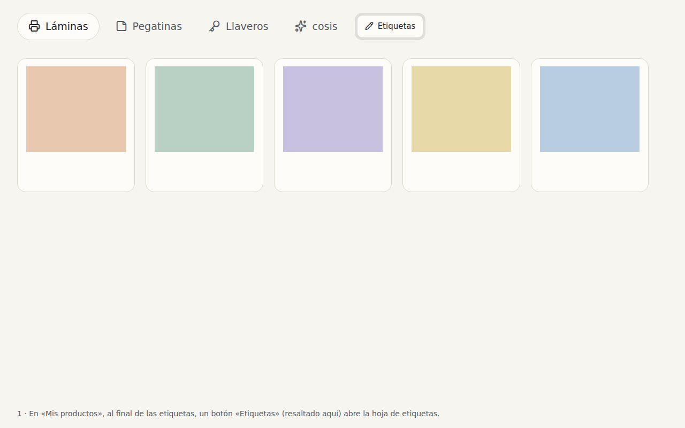
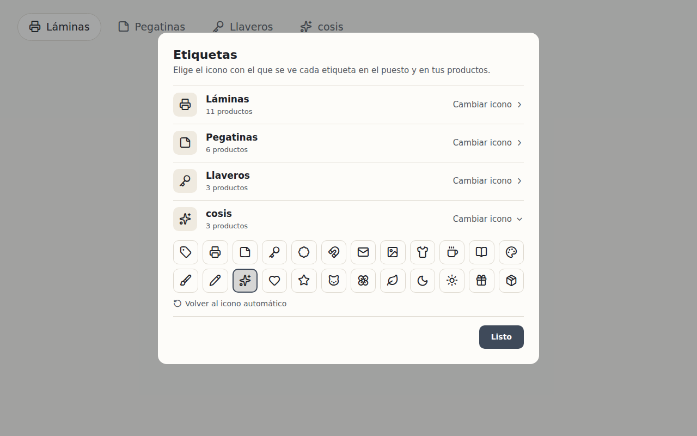
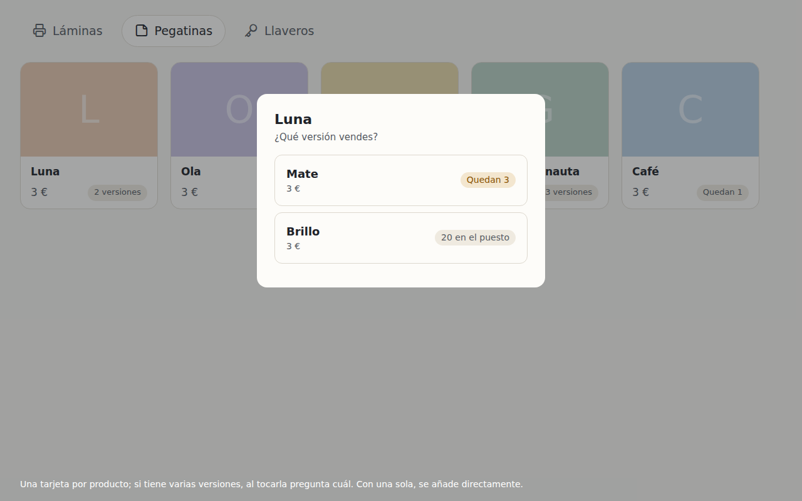

# 7. Tag icons the artist chooses, and one stand card per product

> Status: done · Author's approval: proposal ☑ plan ☑ (2026-10-24) · Lives in: `catalogue` (tags), `stand`
> (the grid), `storage` (a table for the icons)
> Depends on: proposal 6

## Why

**Tag icons.** A tag's icon is guessed from its name («Láminas» gets a printer). A tag the guess
does not know, like «cosis», gets a plain tag, and there is no way to change it.

**The stand.** The grid shows one card per version: «Luna Mate» and «Luna Brillo» side by side,
«Gato astronauta» three times. The grid grows with every version, and the artist looks for a
product, not a version.

## What

### Tag icons

| Id | Requirement | Check |
|---|---|---|
| R1 | In «Mis productos», an «Etiquetas» button after the tag tabs opens a sheet listing every tag, its icon and how many products have it | test `the tags sheet lists every tag` |
| R2 | «Cambiar icono» opens a grid of about two dozen icons for an artist's work; tapping one gives the tag that icon everywhere (stand, catalogue, editor) | test `a chosen icon shows on the tag's tab` |
| R3 | «Volver al icono automático» forgets the choice, and the guess comes back | test `a tag goes back to its guessed icon` |
| R4 | The choice is kept in the database and does not depend on capitals or accents | test on the store |

### One card per product on the stand

| Id | Requirement | Check |
|---|---|---|
| R5 | The stand shows one card per product. A product with several versions says «N versiones» and its lowest price as «desde X €» | test `a product of three versions is one card` |
| R6 | Tapping a product of one version adds it to the sale, as now | existing stand tests |
| R7 | Tapping a product of several versions asks «¿Qué versión vendes?» with a row per version, its price and what is left; a sold-out version cannot be chosen | test `choosing a version adds that version` |

## Out of scope

- Icons outside the curated grid, or uploaded pictures as icons.
- Changing how a sale holds its lines: it still sells versions.

## Design

- **Storage.** A migration adds `icon` to `tag`, empty by default. `Tag.ChosenIcon` holds it and
  `Tag.Icon()` gives it, or the guess of `TagIcon`. `Store.SetTagIcon` sets or clears it.
- **Catalogue.** `catalogue/tags_sheet.go`: the «Etiquetas» button beside the tag tabs, the sheet,
  and a grid of `TagIconChoices`. The tag tabs show each tag's icon too.
- **Stand.** `Item` carries its `ProductID`; `ByProduct` groups the shown items. A product of one
  version keeps its tile; one of several gets a tile with «desde» and a layered pill with the
  count, and a sheet asking for the version (`stand/versions.go`). The «−» to take one out moves
  into that sheet, since a product's tile cannot say which version to take out.

## Tasks

- [x] T1 The tag's icon in the database and the store (R4)
- [x] T2 The tags sheet and the grid of icons; icons on the tag tabs (R1–R3)
- [x] T3 One tile per product, and the question of the version (R5–R7)

## Result

- Built as proposed. Tests: `TestATagKeepsTheIconChosenForItAndForgetsItOnRequest`,
  `TestAnIconChosenForATagIsKeptAndCanBeForgotten`, `TestAProductOfThreeVersionsIsOneTileOnTheStand`,
  `TestChoosingAVersionPutsThatVersionInTheBasket`; the stand's tests now choose a version.
- Changed from the mock-up: the tile's pill shows a layers icon and the count rather than
  «3 versiones», which did not fit beside «desde 10 €».
- Still for a person: try it on the iPad.
