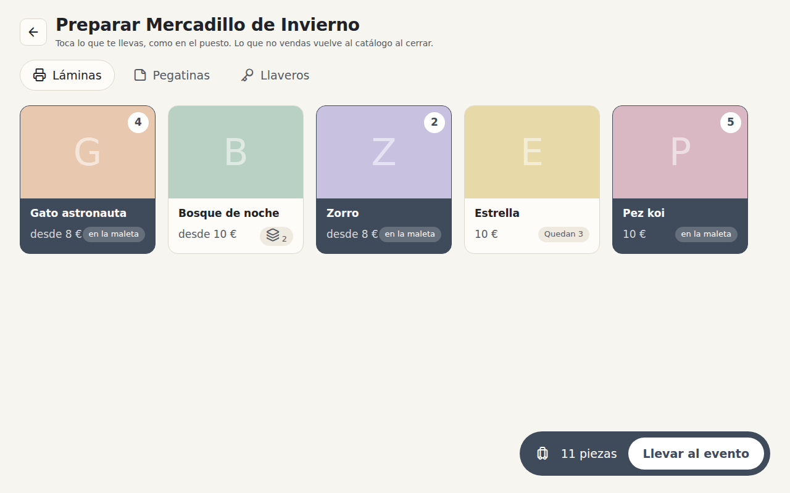

# 8. Pack for an event the way the stand sells

> Status: built, pending review · Author's approval: proposal ☑ plan ☑ (2026-10-24) · Lives in: `stand` (the grid and the
> basket), `events` (where packing starts and what it records)
> Depends on: proposals 6 and 7

## Why

Taking stock to an event is a sheet with a drop-down of every version and a number to type: one
version at a time, reading a long list. The stand already shows the whole catalogue as tiles,
by tag, with search, and a basket that grows with each tap. Packing is the same gesture as
selling, in the other direction.

## What

| Id | Requirement | Check |
|---|---|---|
| R1 | «Llevar» on the event's page, and «Configurar stock» on an empty stand, open «Preparar <evento>»: the stand's grid over the catalogue's stock, with its tags and search | test `packing opens the catalogue's grid` |
| R2 | Each tap puts one more piece in the case («maleta»); a product of several versions asks which one, as on the stand; the tile cannot take more than the catalogue has | test `a tap packs one piece` |
| R3 | The bar at the bottom says how many pieces and «Llevar al evento»; it moves them all to the event at once and goes back to its page | test `packed pieces move to the event` |
| R4 | Leaving without «Llevar al evento» moves nothing | test `leaving packs nothing` |
| R5 | What the event already has does not show as packed: the case only holds what is added now | by design |

## Out of scope

- Returning stock to the catalogue: it stays on each row's «Devolver».
- Typing a quantity for big amounts (taps only, for now); the «−» in the version sheet takes one
  out.

## Design

The stand gains a preparing mode (`stand/preparing.go`) rather than a second grid: `Prepare(event,
done)` opens the whole stock with a header «Preparar …», the case says «en la maleta», and the bar
says «Llevar al evento», which moves each line with `events.Store.MoveStock`. The events page
calls it through `PrepareWith`, given by the app; the old take sheet stays as the fallback when no
one gives it. «Configurar stock» on an empty fair's stand packs and comes back to that stand.

## Tasks

- [x] T1 The packing mode on the stand: header, case words, the bar and moving the stock (R1–R4)
- [x] T2 «Llevar» and «Configurar stock» open it (R1)

## Result

- Built as proposed. Tests: `TestPackedPiecesMoveToTheEvent`, `TestLeavingThePreparingMovesNothing`,
  `TestAFairWithNothingTakenOffersToSetUpItsStock`.
- The lines move one by one: if one is refused (the catalogue ran out meanwhile), the ones before
  it stay moved and the stand says why.
- Still for a person: try it on the iPad.
