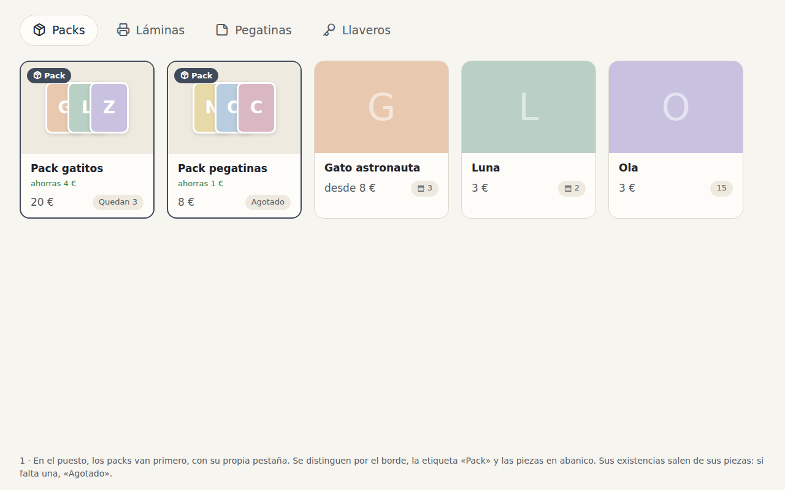
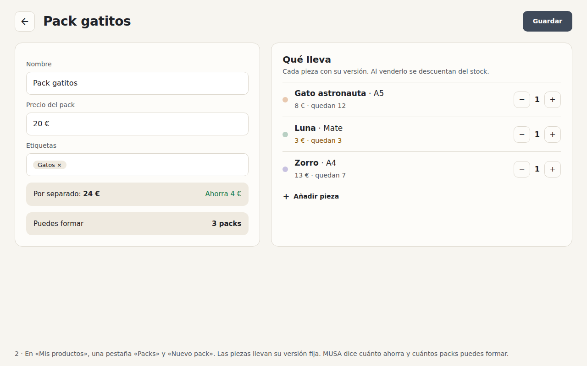

# 9. Packs

> Status: proposed · Author's approval: proposal ☐ plan ☐ · Lives in: `catalogue` (packs and their
> editor), `stand` (selling and preparing them), `sales` (a pack in a sale), `events`, `storage`
> Depends on: proposals 7 and 8. Takes the bundles out of proposal 3, which keeps the rest.

## Why

An artist sells sets at a fair: three prints for 20 € instead of 24 €. Today she can only sell the
pieces one by one and lower the price by hand, which the app cannot do either. The author answered
the open questions on 2026-10-24: packs are sold on the stand and look different from products;
a pack has stock only when its pieces do; each piece is one fixed version, for now; and packs go
to events too.

## What

| Id | Requirement | Check |
|---|---|---|
| R1 | A pack has a name, its own price, tags, and holds pieces: each a fixed version of a product with a quantity; a version can be in several packs | test `a pack holds versions with quantities` |
| R2 | «Mis productos» has a «Packs» tab and «Nuevo pack»; the editor shows what the pieces cost apart, what the pack saves, and how many packs can be made | test `a pack says how many can be made` |
| R3 | How many packs are left is worked out from its pieces: the fewest whole sets they make. With a piece missing, the pack is sold out | test `a pack with a missing piece is sold out` |
| R4 | On the stand, packs come first under their own «Packs» tab, and look apart: an accent edge, a «Pack» label and their pieces fanned out | capture |
| R5 | Selling a pack takes the stock of each piece; undoing the sale gives it back. The sale keeps the pack's name and price as they were | test `selling a pack takes its pieces` |
| R6 | Preparing an event shows the packs too; packing one puts its pieces in the case. At the event, a pack can be sold while its pieces are on the stand | test `a pack is sold at an event from the pieces taken` |
| R7 | A pack and a loose piece draw on the same stock: selling a piece can leave a pack sold out, and the stand shows it at once | test on the stand |
| R8 | Archiving or deleting a product leaves the packs that hold it sold out and says so in their editor | test `a pack of an archived product is sold out` |

## Out of scope

- Choosing a piece's version when selling (fixed, for now).
- Packs of digital products.
- Stock of ready-made packs apart from their pieces.
